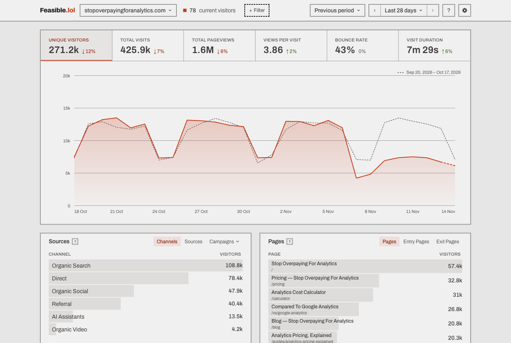

<!--
  README.md
  feasible.lol — open-source, privacy-first web analytics.

  Created: 2026-08-30
  Copyright (c) 2026 Cloudmanic Labs, LLC. All rights reserved.
-->

# feasible.lol

Privacy-first web analytics. One Go binary. One SQLite database per account.

No cookies, no consent banner, and visitor IP addresses are never written to disk. Run it
yourself for free, or let us host it for $99 a year.



## Status

Live in production at [app.feasible.lol](https://app.feasible.lol). The hosted service runs this
code, and the self-hosted build is the same binary with every feature in it.

It's ready for real sites, hosted or on your own server. Releases are still numbered 0.0.x and
ship often. Migrations never run on their own, so run `feasible db migrate` after every upgrade.

## Try it

- **Live demo, no sign-up:**
  [app.feasible.lol/public/stopoverpayingforanalytics.com](https://app.feasible.lol/public/stopoverpayingforanalytics.com).
  The traffic is generated, so click anything.
- **Hosted:** [sign up](https://app.feasible.lol/register) for a 30-day free trial. No card. After
  that it's $9.99 a month or $99 a year for unlimited sites, unlimited teammates and 1,000,000
  pageviews and events a month across all of them. Going over never stops collection or adds a
  charge.
- **Self-hosted:** free, below.

## Self-host

Download the archive for your platform from the
[latest release](https://github.com/Feasible-Analytics/app.feasible.lol/releases/latest). There are
builds for Linux, macOS and Windows, on amd64 and arm64.

```bash
tar -xzf feasible_*_linux_amd64.tar.gz
./feasible --version
```

Or build it from source with Go 1.26 or newer. The compiled dashboard and tracker are committed,
so Node is only needed if you change them.

```bash
go build -o feasible ./cmd/feasible
```

Write the minimum configuration to a file, with your own hostname and email. The salt is generated
once here and has to stay the same afterwards, because it's part of how visitors are counted each
day.

```bash
cat > feasible.env <<EOF
FEASIBLE_ENV=production
FEASIBLE_APP_HOSTED=false
FEASIBLE_APP_BASE_URL=https://stats.example.com
FEASIBLE_APP_LISTEN=127.0.0.1:19301
FEASIBLE_APP_DATA_DIR=./data
FEASIBLE_INGEST_SALT=$(openssl rand -hex 32)
FEASIBLE_OPERATOR_EMAIL=you@example.com
EOF
```

Then create the databases, make your account and start it:

```bash
set -a; . ./feasible.env; set +a
./feasible db migrate
./feasible account create --email you@example.com --name "Your Name"
./feasible serve
```

`account create` prints a generated password once. Sign in at your base URL, add a site, and paste
the snippet it shows you into your pages' `<head>`. The heart of it is one tag:

```html
<script defer data-domain="example.com" src="https://stats.example.com/js/script.js"></script>
```

A few things worth knowing:

- **TLS.** `serve` speaks plain HTTP. Put any TLS proxy in front of it, Caddy or nginx, and set
  `FEASIBLE_APP_BASE_URL` to the public `https://` address.
- **`FEASIBLE_APP_HOSTED=false`** turns off billing, trials, usage limits and public sign-up. Every
  feature stays on. Run `account create` again for each separate account; teammates join by
  invitation from inside the app.
- **Email.** The default `log` transport writes messages to `tmp/mail/` and sends nothing. Set
  `FEASIBLE_APP_MAIL_TRANSPORT=smtp` and `FEASIBLE_SMTP_HOST` so password resets and reports
  actually arrive.
- **Locations.** Drop the free DB-IP Lite country or city `.mmdb` file into `data/geoip/`. Without
  one, locations show as unknown and everything else works.
- **Google.** Sign-in with Google, the GA4 import and Search Console terms share one OAuth client:
  `FEASIBLE_GOOGLE_CLIENT_ID` and `FEASIBLE_GOOGLE_CLIENT_SECRET`. Leave them unset and those
  features hide themselves.
- **Backups.** `./feasible db backup` writes a consistent snapshot of every database. Don't `cp`
  files a running process is writing.

Every variable is documented in [`.env.sample`](.env.sample). The full guide is at
[feasible.lol/docs/self-hosting](https://feasible.lol/docs/self-hosting/).

## What's in it

- **One-page dashboard.** Visitors, visits, pageviews, bounce rate, visit duration, channels,
  sources and all five UTM tags, pages with entry and exit, countries, regions and cities,
  devices, browsers, operating systems and languages. Realtime, filters and period comparison.
- **Goals and funnels.** Custom events and properties, funnels of 2 to 8 steps, revenue by source,
  scroll depth, outbound links, file downloads and 404s. Core Web Vitals, if you turn them on.
- **Search terms** people used to find you, from Google Search Console.
- **Imports.** Google Analytics 4 history by connecting your Google account, or CSV exports from
  another tool. Export your raw data any time.
- **Reports and alerts.** Weekly and monthly email and Slack reports, traffic spike and drop
  alerts, annotations.
- **Sharing.** Teams with roles, guest access to a single site, public or password-protected
  dashboards, two-factor login.
- **Bot filtering you can inspect.** Every dropped event is counted with the reason it was dropped.
- **API.** One key type for the Stats API, the Sites API and signed webhooks.
- **MCP.** Connect Claude, ChatGPT, Cursor or VS Code by pasting one URL and approving it, then ask
  "why did traffic drop last week?" in plain words. `feasible mcp` serves the same tools over stdio.
- **Integrations** in [`ecosystem/`](ecosystem/): a WordPress plugin, a Google Tag Manager template,
  a Looker Studio connector, an npm package for the tracker, and SDKs for Go, Node, PHP, Python and
  Ruby. They aren't published to their stores yet, so install them from here.

## How it's built

- **Go, one binary.** The React dashboard, the server-rendered pages, the tracker, email templates,
  migrations and the bot lists are all embedded with `go:embed`. The release archive is about 8 MB.
  Nothing to copy alongside it.
- **SQLite, one database per account.** A small `system.db` holds users, teams and sites. Each
  account's events live in their own file, through a pure Go driver, so there's no cgo. One
  directory is the whole install.
- **Ingest.** The tracker posts to `/api/event`. The IP address is used in memory for geolocation
  and a daily-salted visitor hash, then dropped before anything is written. Self-hosted, events are
  batched and committed straight to the account's database. Hosted, separate ingest processes
  commit each event to a local SQLite outbox, answer `202`, and forward signed batches to the app
  server that owns the site. A row leaves the outbox only after that server confirms the commit.
- **Reports** read hourly and daily roll-up tables, so a year of data answers in under a second.
- **The tracker** is plain JavaScript, about 3.6 KB gzipped. The build fails if it grows past 3.75
  KiB. Web Vitals is a separate module that loads only on sites that turn it on.
- **Disk.** A million pageviews takes about 300 MB once indexed and rolled up. Write and read
  numbers, and how they were measured, are in
  [`internal/bench/RESULTS.md`](internal/bench/RESULTS.md).

## Why

Privacy-friendly analytics is usually priced per site, per seat or per pageview tier, with funnels,
revenue and the API saved for the top plan. Self-hosting it usually means Docker, a separate
analytics database and a few gigabytes of RAM before you count a single visit.

Feasible is one price with everything in it. The self-hosted build is the same build, with nothing
taken out. If you can run a binary, you can run it.

## Developing

You need Go 1.26 or newer. Node is needed to rebuild the dashboard, the stylesheet or the tracker.
Caddy is only needed for the three-process mode.

```bash
cp .env.sample .env
make build             # compile the front end, then the binary
make dev-solo          # one process, everything in it: the self-hosted shape
```

For the hosted shape, run each process in its own terminal so its logs stay readable:

```bash
make caddy             # :19300, the only port you open in a browser
make app               # :19301, the app and signed internal routes
make ingest            # :19302, events and health
make testsite          # :19303, a real page with the snippet installed
```

`make dev` runs all three at once. Every runnable target has a `-ts` twin (`make app-ts`,
`make dev-ts`) that binds to the Tailscale address and moves `FEASIBLE_APP_BASE_URL` with it, so the
app is reachable from another machine. `make` on its own lists everything.

You don't need local services to develop. Email is written to `tmp/mail/`, a missing geolocation
file means "unknown", and Stripe webhooks come through the CLI:

```bash
stripe listen --forward-to localhost:19301/webhooks/stripe
```

`FEASIBLE_APP_TRANSPORT` picks who owns `/api/event`: `direct` writes from the app process, and
`http` hands it to separate `feasible ingest` processes. [`.env.sample`](.env.sample) covers the
shard and signing settings for the split topology, and
[`ops/load-balancer.md`](ops/load-balancer.md) covers failure and drain behavior. Before the hosted
service takes traffic, `feasible billing preflight --checkout-smoke` checks its Stripe setup.

### Health

Every process serves three endpoints on its one listener:

```bash
curl https://app.feasible.lol/health  # public: can customers use the site
curl localhost:19301/health/live      # internal: is this process running
curl localhost:19301/health/ready     # internal: may this process take traffic
```

Point an uptime monitor at the public `/health` and check the status code. `/health/live` checks
nothing on purpose, so a slow database can't turn into a restart loop. `/health/ready` returns
`503` with a JSON body naming every failed dependency. There's no `/metrics` endpoint.

[`ops/`](ops/) holds the runbooks, the load balancer settings and the game day that breaks things
on purpose to prove the runbooks right.

### Before you push

```bash
make test
make lint
make check-env         # every environment variable is documented in .env.sample
```

### Cutting a release

Releases are a deliberate choice, never automatic. When `main` is stable, run the **Release**
workflow from the Actions tab. Leave the version blank to bump the patch number, or give one like
`1.2.3`. It tags `main`, creates the GitHub Release and attaches Linux, Windows and macOS builds for
amd64 and arm64 with a SHA-256 checksum file.

## License

[GNU AGPL-3.0-or-later](LICENSE). Run it, change it and self-host it freely. If you offer it to
others as a network service, you have to make your source available to those users.

[feasible.lol](https://feasible.lol)
